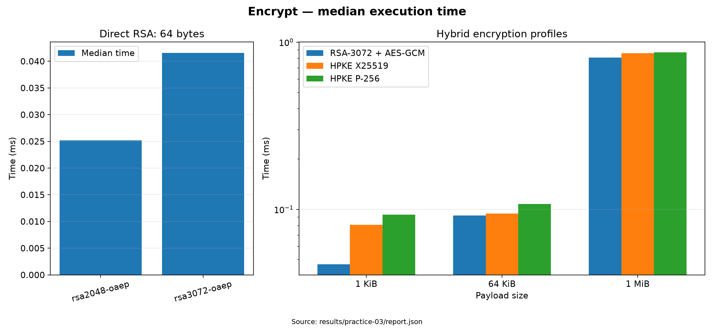
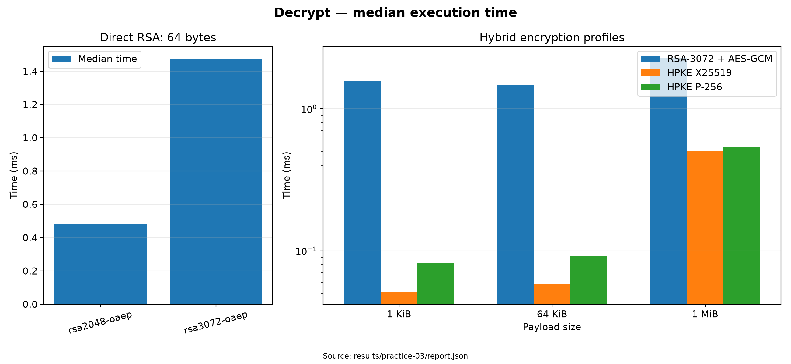
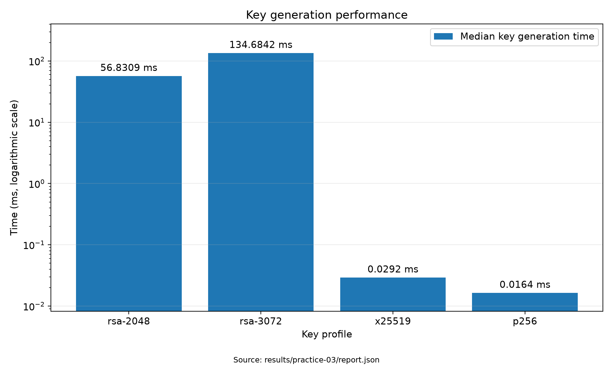

# Результати власного експерименту

Після реалізації `python -m benchmarks.asymmetric_benchmark` створює тут `raw.csv` і `report.json`. Готових числових результатів у стартовій гілці немає.

CSV: `group,profile,operation,payload_bytes,series_index,operations,elapsed_ns,ns_per_operation,ciphertext_bytes`.

Для `key_generation`: `profile` дорівнює `rsa-2048`, `rsa-3072`, `x25519` або `p256`; `operation=keygen`, `payload_bytes=0`, `operations=1`, `ciphertext_bytes=0`. П'ять незалежних рядків на профіль, `series_index=1..5`. Для шифрування/розшифрування — п'ять рядків на кожну комбінацію, `operations=20`. Усього 130 рядків даних, без заголовка.

JSON базового звіту: `schema_version`, `experiment`, `environment`, `key_generation` (4), `results` (22), `checks` (22). Точні поля визначає `app/schemas/asymmetric_report.py`. Типи чисел мають бути скінченними; час додатний; IQR невід'ємний. Генерація ключа вимірюється окремо, а його відкритий DER/SPKI розмір — поза таймером.

`ciphertext_bytes` — розмір сирого двійкового результату, не JSON/Base64. RSA: 256/384 байти; RSA/AES: S+412; HPKE X25519: S+48; HPKE P-256: S+81. Пропускна здатність MiB/s тільки для гібридних результатів: S * 1e9 / (2**20 * median_ns); для прямих RSA — null.

`checks`: чотири перевірки для кожного з п'яти профілів (`roundtrip`, `wrong_key`, `tamper`, `wrong_context`) і `oaep_boundary` для двох прямих RSA. `passed=false` потрібно зберегти як факт невдалої перевірки, а не замінити на true.

Зберігайте версії Python, cryptography 48.0.1, OpenSSL саме цієї бібліотеки, ОС, модель процесора, UTC час та Git SHA коду на момент запуску. Не зберігайте ім'я хоста, користувача, локальні шляхи, ключі, вхідні повідомлення чи шифротексти. Числові результати не є доказом криптографічної стійкості. 
 ## Результати виконаного експерименту

Експеримент виконано успішно:

- 130 рядків сирих вимірювань у raw.csv.
- 4 результати генерації ключів.
- 22 агреговані результати шифрування та розшифрування.
- 22 із 22 успішних перевірок коректності.
- 135 із 135 успішних тестів pytest.
- 4 із 4 успішних тестів Postman.
- Версія API — 0.3.0.

SHA коду на момент експерименту: `c70291e2c40b79210af0e4557f47f785da80d918`.

## Графіки експерименту

Для повторної побудови графіків необхідно встановити matplotlib та виконати:

`python -m benchmarks.plot_asymmetric_results`

Графіки побудовано на основі власних вимірювань із report.json.

## Висновки

У проведеному експерименті RSA-3072 + AES-GCM продемонстрував найвищу пропускну здатність шифрування серед досліджених гібридних профілів, а HPKE X25519 — найвищу пропускну здатність розшифрування.

Результати характеризують продуктивність у конкретному програмному та апаратному середовищі й не є доказом переваги криптографічної стійкості одного алгоритму над іншим.
